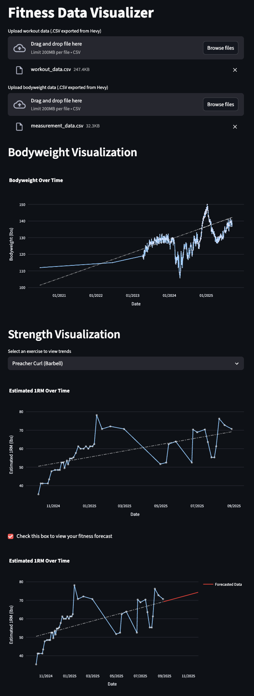
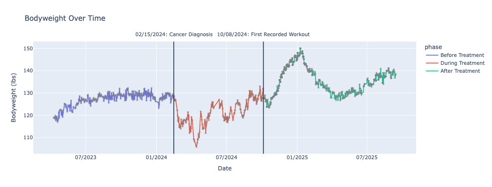

# Fitness Data Visualizer

An interactive web application built with Streamlit, Pandas, and Scikit-learn. This tool turns raw, personal fitness CSVs (from the [Hevy](https://www.hevyapp.com) app) into an interactive data visualization dashboard including a forecast of where your fitness statistics will end up based on your existing data.

[fitnessdatavisualizer.streamlit.app](https://fitnessdatavisualizer.streamlit.app)

---

## Demo



---

## Key Features

* **Predictive Forecasting:** Implemented a **Scikit-learn** Linear Regression model to forecast future strength progression based on historical trends.
* **Advanced Strength Analysis:** Engineered a function to calculate **Estimated 1-Rep Max (e1RM)** from RPE data, creating a standardized metric to track true strength regardless of set/rep variations.
* **Interactive Dashboard:** Built a dynamic web app with **Streamlit** that automatically cleans, merges, and visualizes data from user-uploaded CSVs in real-time.
* **Multi-Phase Event Analysis:** Designed multi-phase visualizations with **Plotly** to analyze and segment personal bodyweight trends before, during, and after a major life event (cancer treatment).

---

## Personal Analysis

A large part of this project was using my own data and statistics in the analysis. I began recording my bodyweight consistently before I was diagnosed with cancer, and continued recording throughout and after treatment. In my analysis, I was able to see these three phases distinctly (as shown below) and also view my personal strength changes over time. 



---

## Tech Stack

* **Language:** Python
* **Web App:** Streamlit
* **Data Science & ML:** Pandas, NumPy, Scikit-learn
* **Data Visualization:** Plotly Express
* **Prototyping:** Jupyter Notebooks

---

## Local Setup

```bash
git clone https://github.com/sheehanr/fitness-data-visualizer.git
cd fitness-data-visualizer
pip install -r requirements.txt
streamlit run app.py
```

Export your workout and measurement data from Hevy (Settings → Export Data) as CSVs and upload both in the app. To try it without your own data, upload the sample files in `data/raw/`.
